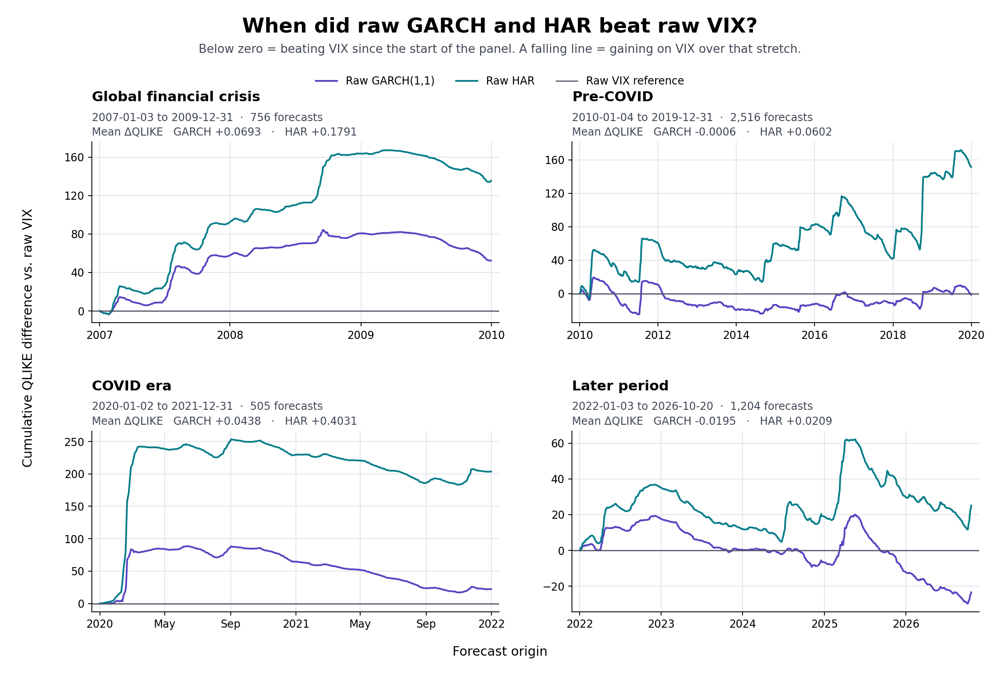
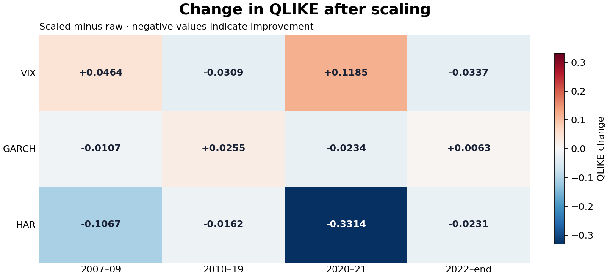
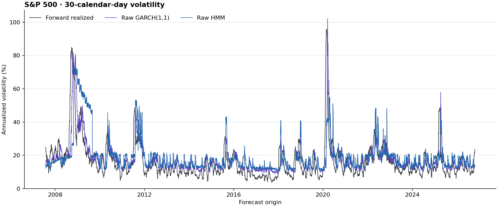

# S&P 500 volatility forecasting

## Purpose & Outcome

This project tries to forecast S&P 500 realized volatility over the next 30 calendar days. We test whether calibrating forecast levels improves accuracy and whether estimating the current volatility regime adds predictive information. We use four forecasting approaches, which use data in different ways:

| Model | How it uses the data |
| --- | --- |
| VIX | Uses the S&P 500 options market’s implied volatility as a forecast. |
| GARCH(1,1) | Updates its daily variance estimate after each new return, then projects that estimate across the next 30 days. |
| HAR | Uses realized variance from the past day, week, and roughly one month to forecast next month variance directly. |
| 3-state Gaussian HMM | Uses daily returns to estimate the probabilities of low, medium, and high volatility regimes. Projects those probabilities forward and combines the state variances into a monthly forecast. |

### Outcomes

- **Calibrated VIX had the lowest overall QLIKE.** Raw VIX and raw GARCH were close. Calibration widened VIX’s lead overall, even though raw VIX scored better than its calibrated version during both crisis periods.
- **Raw HAR had the lowest MAE at 4.99 volatility percentage points.** Calibration improved HAR’s QLIKE and increased its MAE to 6.48 points, showing how the choice of scoring metric changes which forecast looks best.
- **Estimating today’s regime helped the HMM in all four periods.** The filtered HMM starting from current regime probabilities reduced overall QLIKE by 0.295 versus starting from the same model’s long-run regime mix. GARCH still had lower overall forecast error, but the HMM edged it on QLIKE during 2020–2021.

## Data and methods

The dataset contains daily S&P 500 index closes from `arch` and FRED and daily VIX closes from Cboe from the 2006–2026 period. The forecast target is annualized realized variance over the next 30 calendar days, calculated by summing squared daily log returns in that window and multiplying by 365/30. Realized volatility is the square root of that variance.

The models were evaluated walk-forward, using 2006 as initial training history. GARCH, HAR, and our 3-state HMM were refitted every 21 trading sessions on expanding windows. Calibration multipliers used only forecasts whose full 30-day outcomes were already observed. All final comparisons use the same 4,835 forecast dates, with QLIKE on annualized variance and MAE in annualized volatility percentage points.

## Raw benchmark comparison

On the 4,835 forecast dates shared by the final comparisons, raw VIX and raw GARCH were almost tied on QLIKE. Raw HAR had the lowest MAE.

| Model | QLIKE ↓ | MAE ↓ |
| --- | ---: | ---: |
| Raw VIX | **−2.5616** | 6.32 pp |
| Raw GARCH(1,1) | −2.5604 | 5.35 pp |
| Raw HAR | −2.4684 | **4.99 pp** |

The overall QLIKE gap between VIX and GARCH was just 0.0012, but the leader changed by period. VIX led in 2007–2009 and 2020–2021, while GARCH led in 2010–2019 and from 2022 onward, which is shown on the graph. HAR’s lower MAE and higher QLIKE show that the ranking also depended on how forecast errors were measued.



*The graph uses all 4,981 Stage 2 forecast dates. The table uses the 4,835 dates shared by the final comparisons.*

Next we test how adjusting the forecast level changes the overall ranking and whether VIX keeps its advantage during crisis periods.

## Calibration results

Each model’s raw variance forecast was multiplied by a factor estimated from past forecasts whose 30-day outcomes were already known. The factor was fitted to minimize QLIKE.

| Model | QLIKE, raw → scaled | MAE in volatility points, raw → scaled |
| --- | ---: | ---: |
| VIX | −2.5616 → **−2.5678** | 6.32 → 5.64 |
| GARCH(1,1) | −2.5604 → −2.5493 | 5.35 → 6.52 |
| HAR | −2.4684 → −2.5306 | **4.99** → 6.48 |

VIX was the only model that improved on both metrics. HAR had the largest QLIKE improvement, but its MAE increased. GARCH worsened on both metrics. The effect also varied by period. Scaling improved VIX’s QLIKE overall, while raw VIX scored better than scaled VIX during both the financial crisis and COVID periods.



At the project’s 30-calendar-day horizon, scaled VIX had the lowest QLIKE and raw HAR had the lowest MAE among all six raw and scaled variants. This raised a question for the next part, could estimating the market’s current volatility regime from daily returns improve the next 30-day forecast?

## Inferring volatility regimes

Our final experiment tests whether estimating today’s volatility regime improves a 30-day forecast. A 3-state Gaussian HMM learns low, medium, and high-volatility states from daily S&P 500 log returns. At each close, it uses returns observed up to that point to estimate the probability of being in each state, then projects those probabilities forward and sums the expected daily variances over the next 30 days.

To isolate the value of today’s regime estimate, the stationary control uses the same fitted state variances and transition matrix but starts from the model’s long-run regime probabilities.

| Forecast | QLIKE ↓ | MAE ↓ |
| --- | ---: | ---: |
| Stationary HMM | −2.1631 | 10.24 pp |
| Filtered HMM | −2.4579 | 7.17 pp |
| Raw GARCH(1,1) | **−2.5604** | **5.35 pp** |

Starting from today’s regime probabilities improved both metrics in all four periods. Filtering reduced QLIKE by 0.295 and MAE by 3.06 volatility points versus the stationary control. The fitted states had median annualized volatility levels of 8.5%, 20.0%, and 54.0%, and the middle state carried about 40% of the filtered probability on average.

GARCH remained more accurate overall. The filtered HMM only beat GARCH on QLIKE in 2020–2021, by 0.0444, while GARCH had lower MAE in every period. The experiment shows that knowing today’s estimated regime improved the HMM’s own forecasts, with the benefit over GARCH limited to one period under QLIKE.

On 2020-04-01, the HMM forecast 41.80% against 39.40% realized, while GARCH forecast 67.20%. On 2009-08-03, the HMM forecast 50.42% against 17.30% realized and GARCH forecast 20.57%. These are examples from this sample.



## Future work

The first step would be to re-evaluate the saved forecasts on non-overlapping 30-day windows using several starting dates. This would show whether scaled VIX’s tiny QLIKE lead and the filtered HMM’s improvement over its stationary versionn are sensitive to which months are scored. Then it would make sense to test regime-dependent VIX calibration. Since raw VIX performed better than scaled VIX during both crisis periods, a rule based on the HMM’s filtered probability of high volatility could help decide when to use the raw signal. That rule could be fixed in advance and tested against always using raw VIX or always using scaled VIX on a later holdout period.

## How to run

From the repository root, use Python 3.11 or newer and run the stages in order.

```bash
python3 -m venv .venv
source .venv/bin/activate
python -m pip install -r requirements.txt

python src/build_stage1.py
python -m src.compare_stage2
python -m src.plot_stage2_qlike
python -m src.calibrate_stage3
python -m src.compare_stage4
python -m unittest discover -s test -v
```

Stage 1 uses the bundled `arch` S&P 500 history and downloads the FRED S&P 500 and Cboe VIX CSVs when their local snapshots are missing. It reuses snapshots in `data/raw/` on subsequent runs. The published results use a snapshot cutoff of **2026-11-20**. To reproduce those scores exactly, run Stage 1 with the original source snapshots, or copy the original Stage 1 CSVs into `data/processed/` and skip the Stage 1 command. Those inputs are local to the original run. A fresh download can change the data cutoff and, as FRED's history rolls forward, the overlap needed to splice the S&P 500 series.
